<div align="center">
  <a href="https://github.com/Xorions">
    
  </a>
</div>

<div align="center">
  
</div>

<p align="center">
  <a href="https://github.com/Xorions">
    
  </a>
  <a href="https://github.com/Xorions?tab=followers">
    
  </a>
</p>



## 🧭 Focus Map

<p align="center">
  
</p>


## 🖥️ System Identity

```yaml
# ============================================================
#  XORIONS // SYSTEM IDENTITY
# ============================================================
operator: Xorions
status:   ONLINE
base:     Indonesia

roles:
  - AI & Machine Learning
  - Trading Bot & Signal Automation
  - OSINT & Cybersecurity
  - Full-Stack Web Development

stack:
  languages:     [Python, PHP, TypeScript, JavaScript, Go, Kotlin, SQL]
  ai_automation: [signal engines, chart evaluation, LLM tooling, agent workflows]
  web_mobile:    [Laravel, React, Blade, Tailwind CSS, Kotlin Multiplatform]
  security:      [autonomous pentesting, dark-web OSINT, Docker isolation]
  devops:        [Docker, Shell, Git, GitHub Actions]

flagship:
  - ARTEXs ....................... AI autonomous penetration testing system
  - BOT-Sinyal-V2 ................ real-time trading signal engine (v2)
  - BOT-Sinyal-Trading-Experiment  24/7 scanner + chart-based signal evaluation
  - robin ........................ AI-powered dark-web OSINT tool
  - Sistem-Informasi-Posyandu .... Laravel + React health-center platform

metrics:
  public_repos: 15
  followers:    10
  following:    6
  joined:       2025-07-26

motto: "Build signal. Break silence. Ship systems."
# ============================================================
```


## 🚀 Featured Projects

| Project | What it does | Stack |
| :--- | :--- | :--- |
| **[ARTEXs](https://github.com/Xorions/ARTEXs)** | Autonomous AI penetration-testing framework — agent-driven recon, exploitation and reporting. English translation of `Autumn-27/ARTEX` (AGPL-3.0). |     |
| **[BOT-Sinyal-V2](https://github.com/Xorions/BOT-Sinyal-V2)** | Next-generation Python signal engine — the v2 rebuild of the BOT-Sinyal trading bot. |  |
| **[BOT-Sinyal-Trading-Experiment](https://github.com/Xorions/BOT-Sinyal-Trading-Experiment)** | 24/7 market scanner: picks the single best coin (confidence ≥ 65%), sends private signals and posts public chart-based evaluations. |  |
| **[robin](https://github.com/Xorions/robin)** | AI-powered dark-web OSINT tool for crawling, enriching and correlating intelligence from hidden sources. |   |
| **[Sistem-Informasi-Posyandu](https://github.com/Xorions/Sistem-Informasi-Posyandu)** | Integrated posyandu platform: child growth tracking, examinations, nutrition analysis, immunizations and reports — with RBAC for `ADMIN`, `KADER` and `ORANG_TUA`. |      |


## ⚙️ Tech Stack & Arsenal

<p align="center">
  <a href="https://skillicons.dev">
    
  </a>
</p>

| Layer | Technologies |
| :--- | :--- |
| **Languages** | Python · PHP · TypeScript · JavaScript · Go · Kotlin · SQL |
| **AI & Automation** | Trading signal engines · Chart evaluation · OSINT tooling · Agent workflows |
| **Web & Mobile** | Laravel · React · Blade · Tailwind CSS · Kotlin Multiplatform |
| **Security** | Autonomous pentesting (ARTEXs) · Dark-web OSINT (robin) · Docker isolation |
| **DevOps** | Docker · Shell · Git · GitHub Actions |


## 📊 Live GitHub Stats, Streak & Contribution Graph

<p align="center">
  
  
</p>

<p align="center">
  
</p>

<p align="center">
  
</p>


## 🌐 Connect

<p align="center">
  <a href="https://github.com/Xorions">
    
  </a>
  <a href="https://github.com/Xorions?tab=repositories">
    
  </a>
</p>

<p align="center">
  <sub><code>// signal · security · systems — continuously building</code></sub>
</p>


